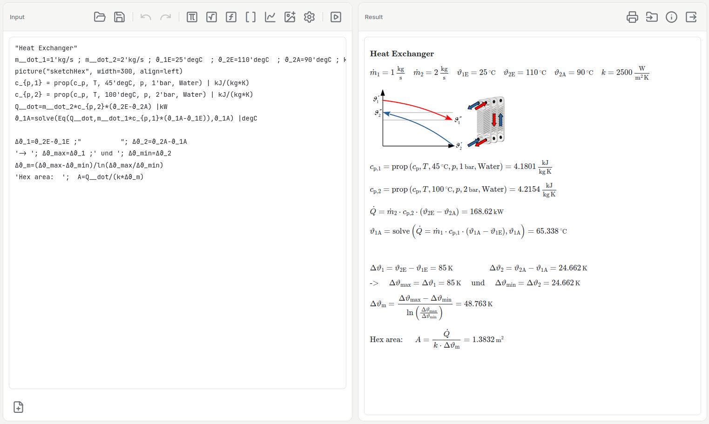
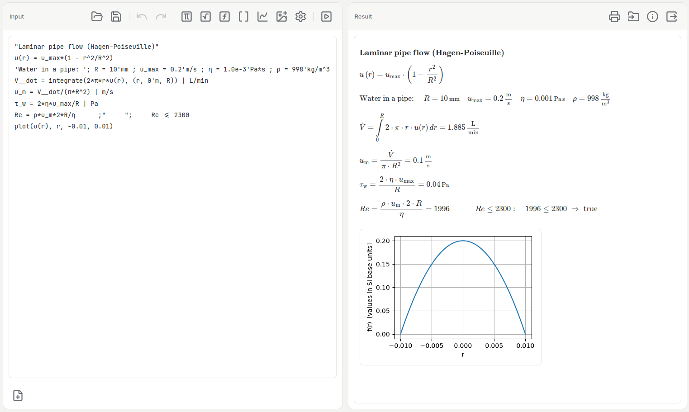
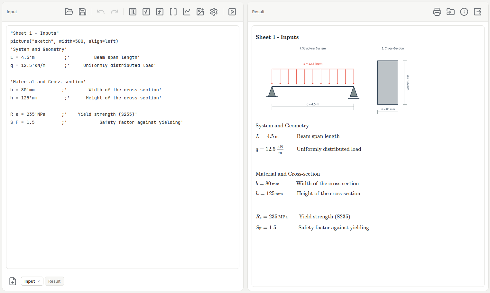
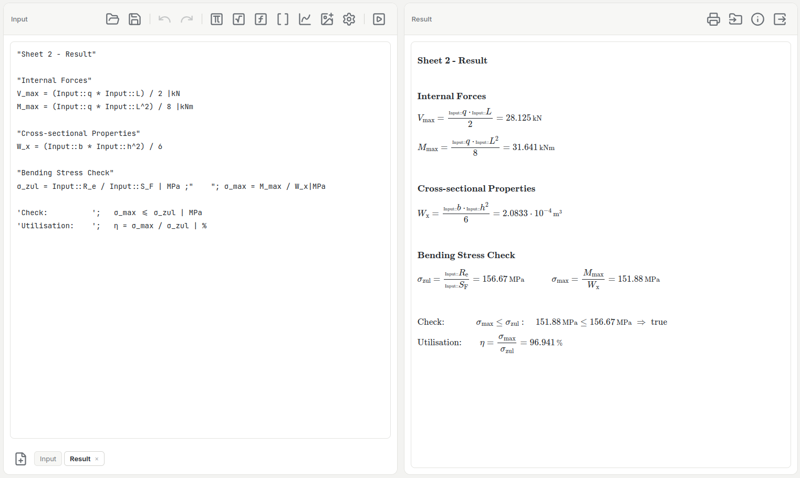
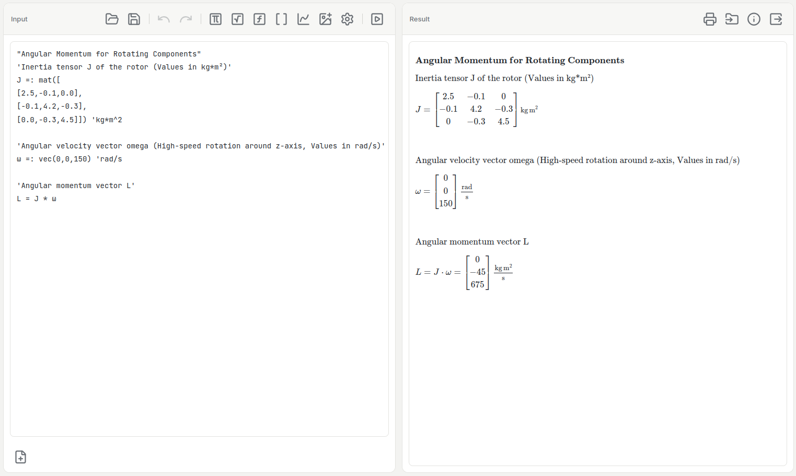
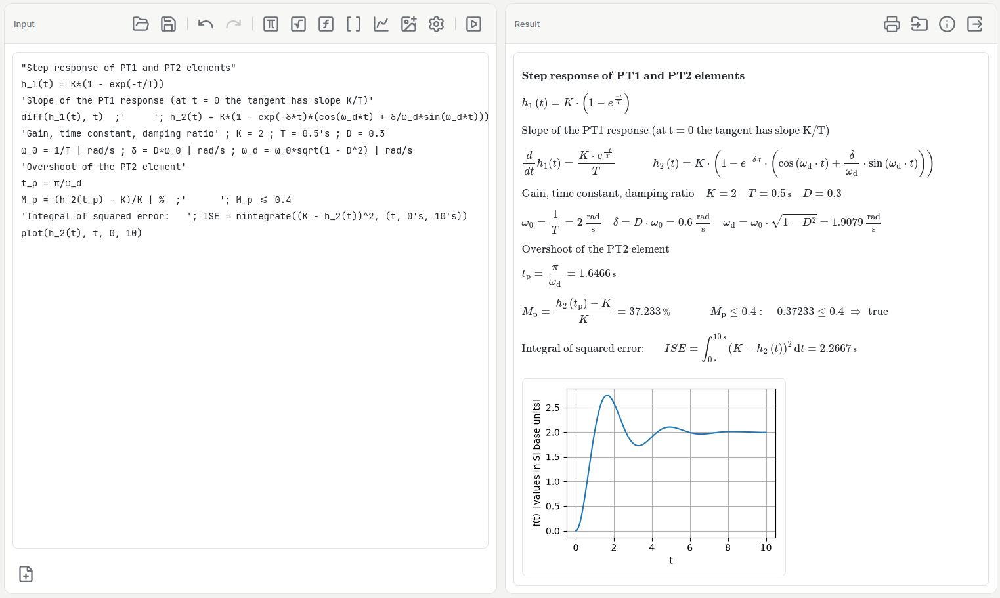

# EngiPad


Free, open-source calculation notebook for engineers: physical units, symbolic math, matrices and plots with instant LaTeX output. Several worksheets in one file, print or export to pdflatex-ready `.tex`. Runs locally on Windows and Linux, no cloud, no account, no internet connection needed.

- Calculate with physical units (`10'kg`, `5'W/(m*K)`, `2'bar | Pa`) and get dimension checks for free
- Symbolic math: derivatives, integrals, equations, sums, products, limits; `simplify`, `expand`, `factor`; `assume(T > 0)` for positive variables
- Your own functions (`f(x) = x^2 + 1`), comparisons and checks (`σ <= σ_zul | MPa` gives *180 MPa ≤ 235 MPa ⇒ true*), `if`, `min`, `max`, rounding
- Vectors, matrices and plots; a matrix can be typed over several lines
- Results typeset with MathJax while you type (optional live update); MathJax and the fonts are part of the program, nothing is loaded from the internet
- **Worksheets:** several named sheets in one file that read each other's values (`Loads::F`)
- **Undo/Redo:** buttons and `Ctrl+Z`/`Ctrl+Y` for the whole workbook (also sheet add/delete/rename), usable on tablets
- **Pictures:** show a PNG sketch in the output with `picture("beam", width=400, align=center)`; it is stored inside the saved text file
- Print or export the sheet(s) as a standalone `.tex` document (with plots and pictures)

The interface consists of a text editor on the left and a LaTeX/plot output area on the right.

## Try the web version

No installation: **[open EngiPad in your browser](https://prfpeste.github.io/EngiPad/?example=static/examples/example_hex.txt)**

Everything runs in the browser (Python compiled to WebAssembly with [Pyodide](https://pyodide.org)); nothing is sent to a server.

- The first visit loads about 45 MB and takes 10–40 seconds, depending on the connection. After that the browser cache keeps the files and EngiPad is ready in about a second.
- Plots and fluid properties (CoolProp) are loaded in the background a few seconds later.
- Works in current Chrome, Edge and Firefox, also on Android. On iPad/iPhone (Safari) the start takes longer.
- Use *Save* to keep your work as a file; the browser only keeps a backup.

## Download

[Download for Windows (.exe)](https://github.com/prfpeste/EngiPad/releases/download/v1.1.6/EngiPad-1.1.6-windows-x86_64.exe)

[Download for Linux (.AppImage)](https://github.com/prfpeste/EngiPad/releases/download/v1.1.6/EngiPad-1.1.6-linux-x86_64.AppImage)

## Screenshots

### Heat transfer – heat exchanger
Fluid properties from CoolProp, solve, a sketch in the output



### Fluid mechanics – laminar pipe flow
Definite integral with units, own function, laminar check, plot



### Mechanics – simply supported beam
Two worksheets (inputs and results), unit conversion, stress check and utilisation




### Mechanics – angular momentum
Matrix and vector with units



### Control engineering – step response
Derivative, overshoot check, numerical integration, plot



## User guide

The complete guide (input syntax, units, worksheets, settings, printing and export) is in **[USER_GUIDE.md](USER_GUIDE.md)**. Fluid properties have their own guide: **[COOLPROP_GUIDE.md](COOLPROP_GUIDE.md)**.

## Features

- Web UI using Flask, HTML/CSS/JavaScript and MathJax
- Expressions are parsed by a small, purpose-built parser and evaluated through a fixed function whitelist — no `eval()`/`sympify()` is ever run on user input (see [Security](#security))
- SymPy integration for symbolic expressions (`diff`, `integrate`, `Eq`, `solve`, `csolve`, `nsolve`, `sum`, `prod`, `lim`, `simplify`, `expand`, `factor`), assumptions with `assume(T > 0)`, numeric evaluation, symbolic display mode (`:=`) and result-only mode (`=:`)
- Unit system: apostrophe syntax (`10'J`, `5'm`), dimension checks, automatic unit simplification, and explicit target units with `| unit` — any product/quotient/power of known units (`| kWh`, `| J/(kg*K)`, `| 1/s`); percent as a value (`40'%`)
- User-defined functions `f(x) = …`, `g(a, b) = …`, usable in `plot`, `nsolve`, `diff`, `integrate`; a function may differentiate with respect to its own parameter (`τ(r) = -η*diff(u(r), r)`, then `τ(R)`)
- **Fluid properties** from [CoolProp](http://www.coolprop.org): `prop(ρ, T, 20'degC, p, 1'bar, Water)` and `haprop(...)` for humid air, with units; usable in functions, plots, `nsolve` and `nintegrate` (see [COOLPROP_GUIDE.md](COOLPROP_GUIDE.md))
- Special functions `erf`, `erfc`, `besselj`, `bessely`, `besseli`, `besselk` (also in plots, without SciPy)
- Comparisons `< > <= >= == !=` with unit checking, `if(condition, a, b)`, `min`, `max`, `round`, `floor`, `ceil`, `sign`, percent display with `| %`
- Vectors and matrices: `vec`, `mat`, `det`, `inv`, `dot`, `cross`, `eigenvals`, indexing from 1 like `v[1]`, `A[2][1]`, `sol[1]`, one unit for a whole vector (`vec(20, 40, 60)'degC`), results with units and `| unit`, …
- Tables: `interp(x, y, value)` and `interp2(...)` (linear interpolation with units, no extrapolation); numerical integration `nintegrate(f, (x, a, b))` with units
- Statements may continue over several lines while a bracket is open (e.g. one matrix row per line)
- `nsolve` with units: the start value carries the unit of the unknown (`nsolve(Eq(...), U, 0.5'V)`)
- Plotting with `plot(f, x, xmin, xmax)`
- **Pictures:** `picture("name", width=300, align=left)` shows a PNG (button *Insert image*). The pictures are stored in the saved text file (Base64 blocks at its end), appear in the printout and in the LaTeX export; at most 10 pictures, total size limited by a setting (1–3 MB)
- **Worksheets:** `##Name` sheets in one text file, tabs below the editor (add, rename by double-click, delete), read-only cross-sheet references `Sheet::var`
- **Live update** on Enter (optional) and **Ctrl+Enter** to calculate
- Text lines (`"bold"`, `'plain'`, spaces preserved) and `#` comments
- Greek variables and accent notation (`Q__dot`, `Q__bar`, `Q__hat`, `Q__tilde`)
- Settings: rounding precision, font size, unit size, sheet-prefix size, print/export all sheets, timeout, image limit, live update
- Print layout with sheet name in the page header; export to `pdflatex`-compilable `.tex` (or `.zip` with plots and pictures), one sheet or all sheets
- Configurable computation timeout protects against very expensive input

## Security

Expressions are evaluated through a custom recursive-descent parser (`parsing/`) and a small AST-to-SymPy bridge (`mathlib/sympy_bridge.py`) that only ever calls a fixed whitelist of functions (`mathlib/functions.py`). Unknown function names become inert symbolic placeholders rather than being executed. No user input is ever passed to Python's `eval()` or SymPy's `sympify()`/`parse_expr()`.

`plot()` and `nsolve()` are the two places where SymPy turns an expression into Python code (`lambdify`). Both refuse any expression that contains an unknown function name before that happens, so a placeholder can never be executed there either. A function defined in the sheet (`f(x) = …`) is stored as a parsed formula, never as text; a call is replaced by that formula through the same parser and whitelist before anything reaches `lambdify`.

The output is HTML-escaped: text from the input (comments, error messages) is shown as text and is never interpreted as HTML by the browser.

Pictures are accepted as **PNG only** and are checked by their bytes (signature, header, end marker) with hard limits for size and pixel count before anything decodes them, so a small file that would expand to gigabytes is refused. Picture names are restricted to letters, digits and underscore, pictures are never read from a file path on the server, and the browser shows them only as `` (no SVG, no scripts). The LaTeX export checks everything again on the server.

Each computation additionally runs in a separate process with a hard timeout (`core/safe_runner.py`, default 10 s) so a single expensive or hanging input can't tie up the server.

The bundled `run.py` binds to `127.0.0.1` by default — if you expose this on a network beyond localhost, review `app.py`/`run.py` first. Behind a reverse proxy, allow request bodies of about 8 MB (e.g. nginx `client_max_body_size 8m;`), otherwise the LaTeX export of a sheet with several pictures is refused by the proxy.

## Requirements

- Python 3
- Python packages: see `requirements.txt` (`Flask`, `Jinja2`, `sympy`, `matplotlib`, `numpy`, `coolprop`). CoolProp is pinned to 6.8.0 (it loads much faster than newer versions) and is optional at run time: without it only `prop` and `haprop` are unavailable
- MathJax 3 and the fonts Inter and JetBrains Mono are included in `static/vendor/`; no CDN is used
- For running the test suite: see `requirements-dev.txt` (`pytest`); the browser tests additionally need `playwright` with Chromium and are skipped without it

```bash
pip install -r requirements.txt
```

## Running from source

```bash
python run.py
```

The application runs on `http://127.0.0.1:5000`. If that port is already in use by another program, EngiPad uses the next free one (5001, 5002, …) and prints the address; the packaged executable opens the browser at the port actually used. `ENGIPAD_PORT` sets the first port to try. As a normal Python script it starts the server without opening a browser; as a packaged executable it also opens the browser automatically.

Optional environment variable: `ENGIPAD_LIVE_DEFAULT=1` or `0` sets whether live update is on by default (on in the local version, off on a server).

## Running the tests

```bash
pip install -r requirements.txt -r requirements-dev.txt
pytest
```

## Building a standalone binary

Ready-made builds are available under [Download](#download). To build your own Linux AppImage or Windows executable/installer, see **[BUILDING.md](BUILDING.md)**.

## Credits

- Author: Prof. Dr. Peter Stein
- Coding: Claude (Anthropic) — the implementation, architecture, tests, and documentation were written with Claude as an AI coding assistant.

## License

This project is licensed under the GNU General Public License v3.0 (GPL-3.0).
See the `LICENSE` file for details.

This project uses ICONS from [Lucide Icons](https://lucide.dev/)

Included third-party files (`static/vendor/`, each with its license file):

- [MathJax](https://www.mathjax.org/) 3.2.2, Apache License 2.0
- Fonts [Inter](https://rsms.me/inter/) and [JetBrains Mono](https://www.jetbrains.com/lp/mono/), SIL Open Font License 1.1

Fluid properties are calculated by [CoolProp](http://www.coolprop.org) (MIT licence), installed as a Python package and included in the downloads.
