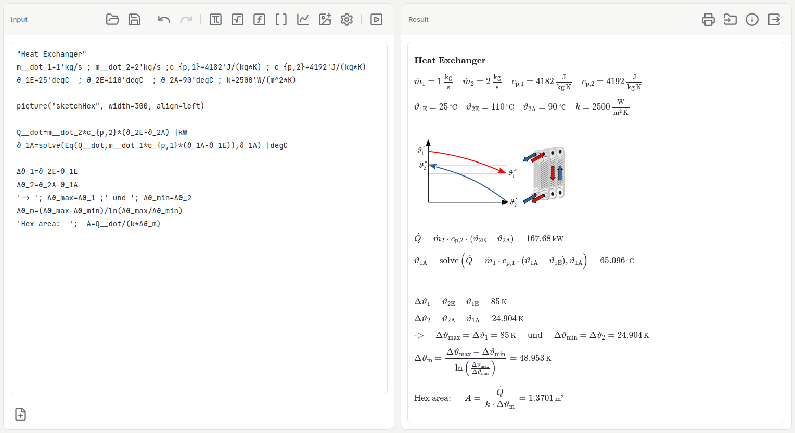
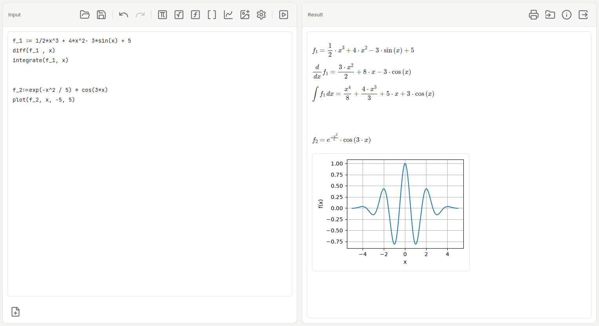
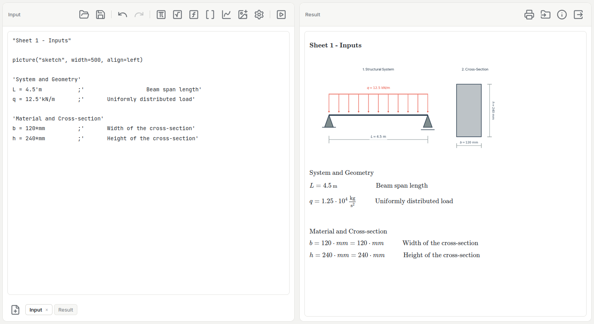
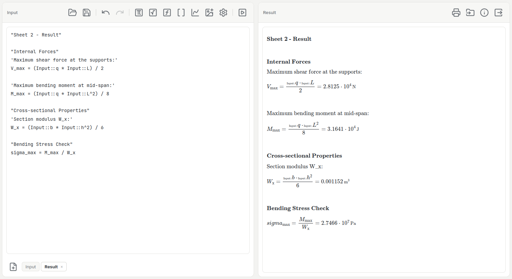
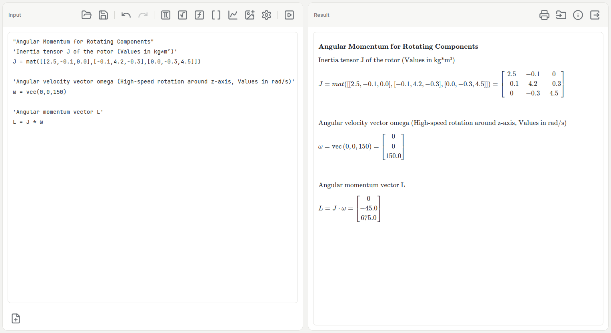

# EngiPad


Free, open-source calculation notebook for engineers: physical units, symbolic math, matrices and plots with instant LaTeX output. Several worksheets in one file, print or export to pdflatex-ready `.tex`. Runs locally on Windows and Linux, no cloud, no account.

- Calculate with physical units (`10'kg`, `5'W/(m*K)`, `2'bar | Pa`) and get dimension checks for free
- Symbolic math: derivatives, integrals, equations, sums, products, limits
- Vectors, matrices and plots
- Results typeset with MathJax while you type (optional live update)
- **Worksheets:** several named sheets in one file that read each other's values (`Loads::F`)
- **Undo/Redo:** buttons and `Ctrl+Z`/`Ctrl+Y` for the whole workbook (also sheet add/delete/rename), usable on tablets
- **Pictures:** show a PNG sketch in the output with `picture("beam", width=400, align=center)`; it is stored inside the saved text file
- Print or export the sheet(s) as a standalone `.tex` document (with plots and pictures)

The interface consists of a text editor on the left and a LaTeX/plot output area on the right.

## Download

[Download for Windows (.exe)](https://github.com/prfpeste/EngiPad/releases/download/v1.1.5/EngiPad-1.1.5-windows-x86_64.exe)

[Download for Linux (.AppImage)](https://github.com/prfpeste/EngiPad/releases/download/v1.1.5/EngiPad-1.1.5-linux-x86_64.AppImage)

## Screenshot







## User guide

The complete guide (input syntax, units, worksheets, settings, printing and export) is in **[USER_GUIDE.md](USER_GUIDE.md)**.

## Features

- Web UI using Flask, HTML/CSS/JavaScript and MathJax
- Expressions are parsed by a small, purpose-built parser and evaluated through a fixed function whitelist — no `eval()`/`sympify()` is ever run on user input (see [Security](#security))
- SymPy integration for symbolic expressions (`diff`, `integrate`, `Eq`, `solve`, `csolve`, `nsolve`, `sum`, `prod`, `lim`), numeric evaluation and symbolic display mode (`:=`)
- Unit system: apostrophe syntax (`10'J`, `5'm`), dimension checks, automatic unit simplification, and explicit target units with `| unit` — any product/quotient/power of known units (`| kWh`, `| J/(kg*K)`)
- Vectors and matrices: `vec`, `mat`, `det`, `inv`, `dot`, `cross`, `eigenvals`, indexing like `sol[0]`, …
- Plotting with `plot(f, x, xmin, xmax)`
- Pictures: `picture("name", width=300, align=left)` shows a PNG (button *Insert image*). The pictures are stored in the saved text file (Base64 blocks at its end), appear in the printout and in the LaTeX export; at most 10 pictures, total size limited by a setting (1–3 MB)
- Worksheets: `##Name` sheets in one text file, tabs below the editor (add, rename by double-click, delete), read-only cross-sheet references `Sheet::var`
- Live update on Enter (optional) and Ctrl+Enter to calculate
- Text lines (`"bold"`, `'plain'`, spaces preserved) and `#` comments
- Greek variables and accent notation (`Q__dot`, `Q__bar`, `Q__hat`, `Q__tilde`)
- Settings: rounding precision, font size, unit size, sheet-prefix size, print/export all sheets, timeout, image limit, live update
- Print layout with sheet name in the page header; export to `pdflatex`-compilable `.tex` (or `.zip` with plots and pictures), one sheet or all sheets
- Configurable computation timeout protects against very expensive input

## Security

Expressions are evaluated through a custom recursive-descent parser (`parsing/`) and a small AST-to-SymPy bridge (`mathlib/sympy_bridge.py`) that only ever calls a fixed whitelist of functions (`mathlib/functions.py`). Unknown function names become inert symbolic placeholders rather than being executed. No user input is ever passed to Python's `eval()` or SymPy's `sympify()`/`parse_expr()`.

Pictures are accepted as **PNG only** and are checked by their bytes (signature, header, end marker) with hard limits for size and pixel count before anything decodes them, so a small file that would expand to gigabytes is refused. Picture names are restricted to letters, digits and underscore, pictures are never read from a file path on the server, and the browser shows them only as `` (no SVG, no scripts). The LaTeX export checks everything again on the server.

Each computation additionally runs in a separate process with a hard timeout (`core/safe_runner.py`, default 10 s) so a single expensive or hanging input can't tie up the server.

The bundled `run.py` binds to `127.0.0.1` by default — if you expose this on a network beyond localhost, review `app.py`/`run.py` first. Behind a reverse proxy, allow request bodies of about 8 MB (e.g. nginx `client_max_body_size 8m;`), otherwise the LaTeX export of a sheet with several pictures is refused by the proxy.

## Requirements

- Python 3
- Python packages: see `requirements.txt` (`Flask`, `Jinja2`, `sympy`, `matplotlib`, `numpy`)
- For running the test suite: see `requirements-dev.txt` (`pytest`)

```bash
pip install -r requirements.txt
```

## Running from source

```bash
python run.py
```

The application runs on `http://127.0.0.1:5000`. As a normal Python script it starts the Flask development server; as a packaged executable it also opens the browser automatically.

Optional environment variable: `ENGIPAD_LIVE_DEFAULT=1` or `0` sets whether live update is on by default (on in the local version, off on a server).

## Running the tests

```bash
pip install -r requirements.txt -r requirements-dev.txt
pytest
```

## Building a standalone binary

Ready-made builds are available under [Download](#download). To build your own Linux AppImage or Windows executable/installer, see **[BUILDING.md](BUILDING.md)**.

## Credits

- Author: Prof. Dr. Peter Stein
- Coding: Claude (Anthropic) — the implementation, architecture, tests, and documentation were written with Claude as an AI coding assistant.

## License

This project is licensed under the GNU General Public License v3.0 (GPL-3.0).
See the `LICENSE` file for details.

This project uses ICONS from [Lucide Icons](https://lucide.dev/)
